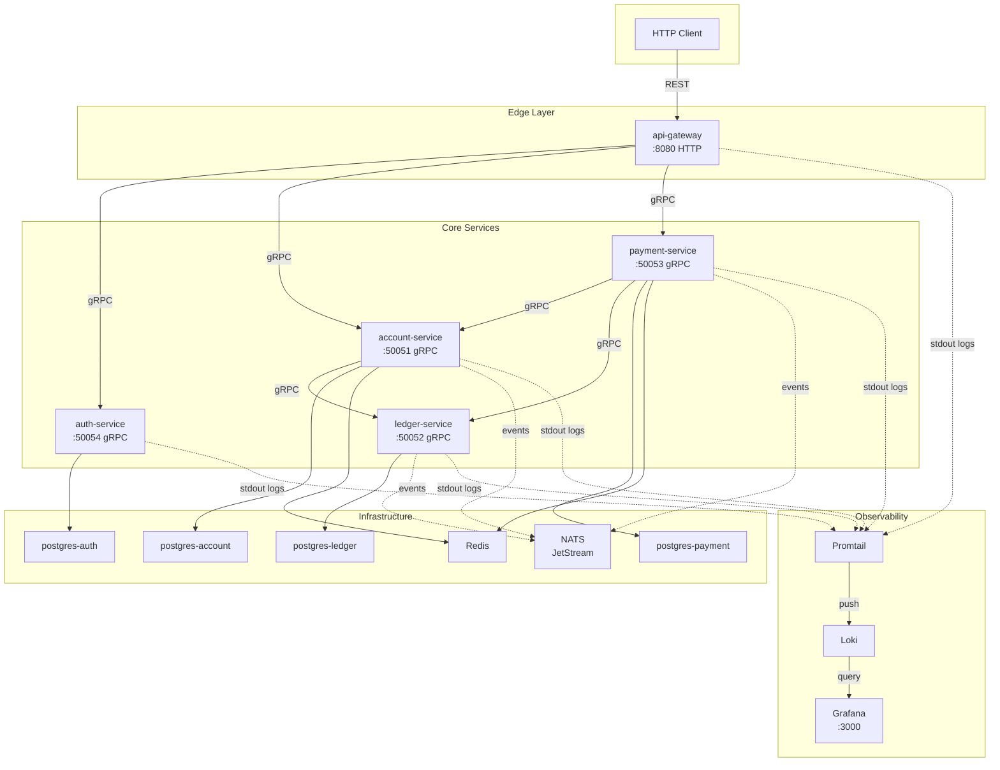
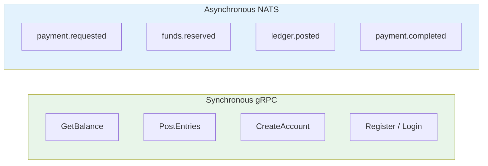
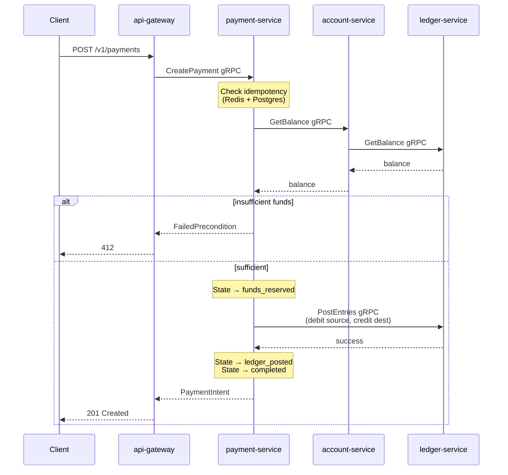
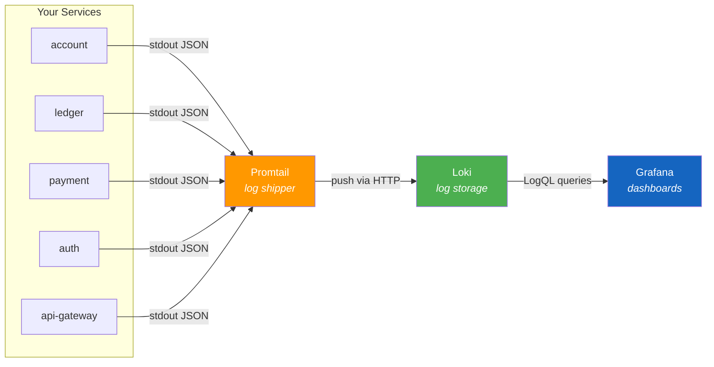

# Payment System

> A distributed payment platform built with Go microservices, gRPC, and event-driven architecture — designed to teach production-grade system design through a real financial domain.

<p align="center">
  
  
  
  <a href="LICENSE"></a>
</p>


## What It Does

| Feature | Description |
|---------|-------------|
| **Account Management** | Create accounts with currency designation and lifecycle states (active/frozen/closed) |
| **Double-Entry Ledger** | Every monetary movement produces matching debit/credit entries — money is never created or destroyed |
| **Payment Processing** | Orchestrated state machine: created → funds reserved → ledger posted → completed |
| **Idempotency** | Two-layer exactly-once semantics (Redis fast path + Postgres durable guard) — replay a payment key 1000 times, get 1 result |
| **JWT Authentication** | RSA-signed access tokens (15min) + refresh tokens (7 days) with edge enforcement at the API gateway |
| **Event-Driven Saga** | Choreographed payment flow via NATS JetStream with outbox pattern for reliable event publication |
| **Balance Caching** | Redis with 60s TTL, invalidated via `ledger.posted` events — sub-millisecond reads for hot accounts |
| **Circuit Breaking** | Every cross-service gRPC call is protected by circuit breakers and retry with exponential backoff |


## Architecture



### Service Boundaries

Every service owns its database — **no service queries another's database directly**. All cross-service access goes through gRPC or events.

| Service | Owns | Database | Communication |
|---------|------|----------|---------------|
| **api-gateway** | Nothing (stateless proxy) | None | REST → gRPC translation, auth enforcement |
| **auth-service** | Users, credentials, tokens | `auth_db` | Synchronous gRPC only |
| **account-service** | Accounts, balance cache | `account_db` | gRPC + consumes `ledger.posted` events |
| **ledger-service** | Ledger entries (immutable) | `ledger_db` | gRPC + publishes `ledger.posted` events |
| **payment-service** | Payment intents, idempotency | `payment_db` | gRPC + consumes/publishes saga events |

### Sync vs Async Boundary



**Why this split?** Reads and atomic writes need immediate confirmation (gRPC). Multi-service workflows like payment processing must survive partial failures (events). A crashed notification service should never break a payment.


## Payment Flow



**Key design decisions:**

- **Money as integers** — `amount_minor` is always `BIGINT` in the smallest currency unit. No `float64` anywhere.
- **Balance is derived, not stored** — Balance = `SUM(credits) - SUM(debits)` from the immutable ledger.
- **Idempotency is two-layer** — Redis `SETNX` for speed, Postgres `UNIQUE` constraint for durability.


## Observability

When something breaks — a payment fails, latency spikes, a service crashes — you need answers fast. The observability stack gives you **one place to search all logs** and **visual dashboards** for system health at a glance.

### How It Works



No code changes were needed. Every service already writes structured JSON to stdout via Go's `slog`. Promtail picks them up from Docker automatically.

### The Tools

| Tool | Role | Why |
|------|------|-----|
| **Loki** | Stores and indexes logs | Indexes labels only (container name, level) — uses 10× less RAM than Elasticsearch |
| **Promtail** | Ships logs to Loki | Native Docker integration — tails stdout, parses JSON fields (`level`, `service`, `method`, `duration`) |
| **Grafana** | Single UI for everything | Same query language for logs (LogQL) and metrics (PromQL) — learn one, know both |

**Quick start:** `docker compose up -d loki promtail grafana` → open `http://localhost:3000` (admin/admin)


## Tech Stack

| Category | Choice | Why |
|----------|--------|-----|
| **Language** | Go 1.26 | Zero-cost abstractions, excellent concurrency, single binary deployment |
| **RPC** | gRPC + Protobuf | Strongly-typed contracts, streaming support, polyglot clients |
| **Message Broker** | NATS JetStream | 10M msgs/sec, at-least-once delivery, simple operations (single binary) |
| **Primary DB** | PostgreSQL 18 | Strong consistency, advisory locks for per-account serialization |
| **Cache** | Redis 8 | Sub-millisecond reads, built-in TTL, SETNX for distributed locking |
| **Auth** | JWT (RS256) | Asymmetric signing — auth-service signs, api-gateway verifies |
| **Container** | Docker + Compose | Reproducible dev environments, multi-stage builds for minimal images |
| **Orchestration** | Kubernetes + Kustomize | Environment overlays (dev/prod), declarative config, no Helm complexity |
| **CI** | GitHub Actions | Per-service path-filtered workflows |
| **Observability** | Loki + Promtail + Grafana | Centralized log aggregation, JSON-parsed structured logs, dashboards |


## Quick Start

### Prerequisites

- Go 1.26+
- Docker & Docker Compose
- `buf` CLI (for proto generation)
- `make`

### 1. Clone & Build

```bash
git clone <repo-url>
cd payment-system

# Generate proto code
make proto-gen

# Build all services
make build
```

### 2. Run with Docker Compose

```bash
# Generate RSA keys for JWT
./deploy/generate-keys.sh

# Start everything (Postgres ×4, Redis, NATS, 5 microservices, observability)
make docker-up

# Verify
curl http://localhost:8080/healthz
# → ok
```

### 3. Run with Kubernetes (kind)

```bash
kind create cluster --name payment-system

docker compose build

kind load docker-image payment-system-account:latest     --name payment-system
kind load docker-image payment-system-api-gateway:latest --name payment-system
kind load docker-image payment-system-auth:latest        --name payment-system
kind load docker-image payment-system-ledger:latest      --name payment-system
kind load docker-image payment-system-payment:latest     --name payment-system

kubectl apply -k deploy/k8s/overlays/dev
kubectl port-forward -n payment-system service/api-gateway 8080:8080
```


## Makefile Reference

```bash
make help              # List all commands
make build             # Compile all services to bin/
make test              # Run all unit tests
make lint              # go vet all modules
make fmt               # Format all Go code
make proto-gen         # Regenerate gRPC/protobuf code
make docker-up         # Start Docker Compose stack (includes Grafana at :3000)
make docker-down       # Stop everything
make migrate-up        # Apply database migrations
make generate-keys     # Generate RSA key pair for JWT
make ci                # Run full CI pipeline locally
make ci-account        # Run CI for account-service only
```


## API Reference

All endpoints at `http://localhost:8080`. All request and response bodies are JSON unless noted.

### Auth

#### `POST /v1/auth/register`

Register a new user. Email must contain `@`, password must be ≥ 8 characters.

| Auth |
|------|
| None |

**Request**
```json
{
  "email": "alice@example.com",
  "password": "password123"
}
```

| Status | Response |
|--------|----------|
| `201` | `{ "message": "user registered successfully" }` |
| `400` | `{ "code": "InvalidArgument", "message": "password must be at least 8 characters" }` |
| `409` | `{ "code": "AlreadyExists", "message": "email already registered" }` |

#### `POST /v1/auth/login`

Authenticate and receive JWT tokens. Access token expires in 15 minutes.

| Auth |
|------|
| None |

**Request**
```json
{
  "email": "alice@example.com",
  "password": "password123"
}
```

| Status | Response |
|--------|----------|
| `200` | `{ "access_token": "eyJ...", "refresh_token": "eyJ...", "expires_in": 900 }` |
| `400` | `{ "code": "InvalidArgument", "message": "invalid email or password" }` |


### Accounts

#### `POST /v1/accounts`

Create a new payment account. Currency must be a 3-letter ISO 4217 code.

| Auth |
|------|
| `Bearer <token>` |

**Request**
```json
{
  "owner_ref": "Alice",
  "currency": "USD"
}
```

| Status | Response |
|--------|----------|
| `201` | `{ "id": "550e8400-e29b-41d4-a716-446655440000", "owner_ref": "Alice", "currency": "USD", "status": "active", "created_at": "2026-08-01T07:00:00Z" }` |
| `400` | `{ "code": "InvalidArgument", "message": "currency must be a 3-letter ISO 4217 code" }` |
| `401` | `{ "code": "UNAUTHORIZED", "message": "missing Authorization header" }` |

#### `GET /v1/accounts/{id}`

Retrieve an account by its UUID.

| Auth |
|------|
| `Bearer <token>` |

**Request** — Path parameter `id` is the account UUID.

| Status | Response |
|--------|----------|
| `200` | `{ "id": "550e8400-e29b-41d4-a716-446655440000", "owner_ref": "Alice", "currency": "USD", "status": "active", "created_at": "2026-08-01T07:00:00Z" }` |
| `404` | `{ "code": "NotFound", "message": "account 550e8400-... not found" }` |

#### `POST /v1/accounts/{id}/deposit`

Add funds to an account. Account must be active and currency must match.

| Auth |
|------|
| `Bearer <token>` |

**Request**
```json
{
  "amount_minor": 5000,
  "currency": "USD"
}
```

| Status | Response |
|--------|----------|
| `200` | `{ "account_id": "550e8400-e29b-41d4-a716-446655440000", "balance_minor": 5000, "currency": "USD" }` |
| `400` | `{ "code": "InvalidArgument", "message": "amount must be positive" }` |
| `412` | `{ "code": "FailedPrecondition", "message": "account is not active (status: closed)" }` |


### Payments

#### `POST /v1/payments`

Create a payment between two accounts. `amount_minor` is in the smallest currency unit (cents). The `idempotency_key` guarantees exactly-once semantics — replay the same key and get the original result back.

| Auth |
|------|
| `Bearer <token>` |

**Request**
```json
{
  "idempotency_key": "pay-001",
  "source_account_id": "550e8400-e29b-41d4-a716-446655440000",
  "destination_account_id": "660e8400-e29b-41d4-a716-446655440001",
  "amount_minor": 1000,
  "currency": "USD"
}
```

| Status | Response |
|--------|----------|
| `201` | `{ "id": "770e8400-...", "idempotency_key": "pay-001", "source_account_id": "550e8400-...", "destination_account_id": "660e8400-...", "amount_minor": 1000, "currency": "USD", "status": "completed", "created_at": "2026-08-01T07:00:00Z", "updated_at": "2026-08-01T07:00:00Z" }` |
| `400` | `{ "code": "InvalidArgument", "message": "source and destination accounts must differ" }` |
| `412` | `{ "code": "FailedPrecondition", "message": "insufficient funds: available 3000, required 999999" }` |

#### `GET /v1/payments/{id}`

Retrieve a payment by its UUID.

| Auth |
|------|
| `Bearer <token>` |

**Request** — Path parameter `id` is the payment UUID.

| Status | Response |
|--------|----------|
| `200` | `{ "id": "770e8400-...", "idempotency_key": "pay-001", "source_account_id": "550e8400-...", "destination_account_id": "660e8400-...", "amount_minor": 1000, "currency": "USD", "status": "completed", "created_at": "...", "updated_at": "..." }` |
| `404` | `{ "code": "NotFound", "message": "payment 770e8400-... not found" }` |


### Health

#### `GET /healthz`

Liveness check.

| Auth | Response |
|------|----------|
| None | `ok` (plain text, HTTP 200) |


## Project Structure

```
payment-system/
├── services/               # Microservices (each has its own go.mod)
│   ├── account/            #   Accounts, balance caching
│   ├── api-gateway/        #   REST → gRPC proxy, auth enforcement
│   ├── auth/               #   User identity, JWT
│   ├── ledger/             #   Immutable double-entry ledger
│   └── payment/            #   Payment orchestration, idempotency
├── shared/                 # Shared libraries (middleware, errors, eventbus, logger, metrics)
├── proto/                  # Protobuf contracts (buf-managed)
├── gen/go/                 # Generated gRPC/protobuf code
├── deploy/
│   ├── k8s/                # Kubernetes manifests (Kustomize: base + overlays)
│   └── observability/      # Loki, Promtail, Prometheus, Grafana configs
├── docs/                   # ADRs, domain model, roadmap, observability guide
├── .github/workflows/      # Per-service path-filtered CI
├── docker-compose.yml      # Full stack (services + infra + observability)
└── Makefile                # Build, test, deploy, CI targets
```


## CI/CD

Every service has its own path-filtered GitHub Actions workflow. Changing `services/auth/cmd/main.go` triggers **only** auth CI. Changing `shared/middleware/` triggers **all** workflows. Each workflow: lint → unit test (race) → Docker build.

Run locally: `make ci-account` or `make ci`.

## License

MIT — see [LICENSE](LICENSE).
